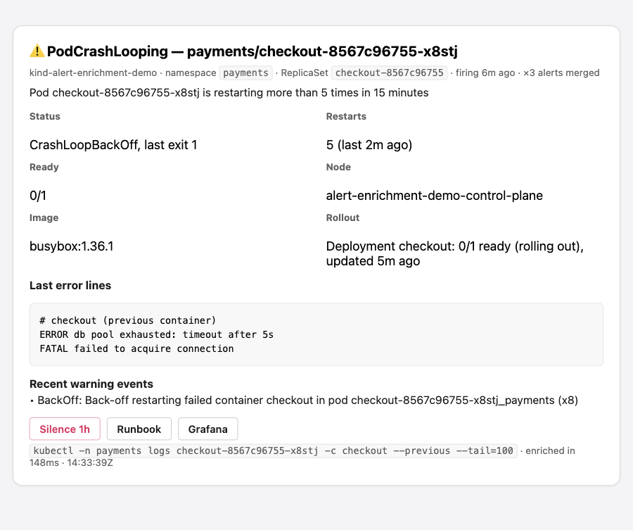

# Alert Enrichment Service

**Alertmanager tells you *what* fired. This tells you *why* — and puts the whole story in one Slack message.**

[](https://github.com/neha1301/alertbrief/actions/workflows/ci.yml)
[](https://github.com/neha1301/alertbrief/actions/workflows/e2e.yml)


I built this because I was tired of watching on-call engineers do the same five
`kubectl` commands at 3 a.m. A raw `PodCrashLooping` webhook gives you a pod name
and a runbook link. The *reason* is scattered across pod status, restart counts,
rollout history, `--previous` logs and warning events — so the first five minutes
of every incident are spent gathering context instead of fixing the problem.

This service sits between Alertmanager and Slack. It resolves the alert to a
workload, reads live cluster state inside a **4-second budget**, collapses
duplicates, and publishes **one** Block Kit message with a pre-filled silence
link and a copy-paste `kubectl` command.



<sub>Rendered from a real sink payload produced by the kind demo: a genuinely
crash-looping `checkout` pod, three alerts about it, one message.</sub>

---

## What changes at 3 a.m.

| | Before | After |
| --- | --- | --- |
| Notification | three separate pings for one broken pod | **one message — ×3 alerts merged** |
| Context | pod name + runbook link | status, restarts, node, owner, rollout, previous logs, events |
| First action | open a laptop, run five `kubectl` commands | click **Silence** or copy one command |
| Retry after timeout | duplicate Slack message | `202 sent=0, suppressed=1` |
| Flapping pod | a webhook every cycle | one message per incident key per `DEDUP_TTL_SECONDS` |

## Receipts

| Signal | Number |
| --- | --- |
| Test suite | **75 passing**, 1 live-cluster e2e |
| Branch coverage | **91.34%** (85% gate, enforced in CI) |
| Enrichment budget | **4s** — partial context beats a dropped alert |
| Per-call Kubernetes timeout | **1.5s**, hard limit |
| Alerts per incident | **3 → 1** Slack message |
| Dedup backends | memory + Redis (atomic Lua reservation) |
| CI matrix | Python **3.12** and **3.13** |

## Why not just Alertmanager grouping?

Alertmanager groups **routes**. It cannot fold four different alert names about
one broken pod into one message, and its `repeat_interval` is not a debounce
per incident. This service handles the incident-level cases:

| Situation | Alertmanager | This service |
| --- | --- | --- |
| `PodCrashLooping` + `PodNotReady` + `HighRestartCount` on one pod | separate groups | one message: **×3 alerts merged** |
| the same webhook retried after a timeout | duplicate delivery | second request returns `202`, `sent=0, suppressed=1` |
| a flapping pod firing → resolved → firing | a webhook every cycle | one message per incident key per `DEDUP_TTL_SECONDS` |

Cross-pod grouping is still Alertmanager's job. The details and rejected
alternatives are in [DESIGN.md](DESIGN.md).

## What gets added to a raw alert

| Raw alert | Enriched message |
| --- | --- |
| `PodCrashLooping` | `CrashLoopBackOff`, 5 restarts, last exit 1, last 2m ago |
| pod name only | namespace, node, owner Deployment/ReplicaSet, image tag |
| nothing about deploys | rollout `0/1 ready (rolling out)`, updated 5m ago |
| "check the logs" | last error lines from the **previous** container, with fallback |
| `runbook_url` / `dashboard_url` annotations | Runbook + Grafana + pre-scoped Silence buttons |
| a burst of alerts | `×3 alerts merged` in the context line |

## How it works

```text
Alertmanager
    │  POST /webhook/alertmanager   (v4 payload, up to 10 alerts)
    ▼
FastAPI ── group by incident key (cluster, namespace, pod, container, severity)
    │
    ├─ 1. reserve key in dedup store ──── duplicate? ──▶ 202 suppressed, done
    │
    ├─ 2. enrich from the Kubernetes API, inside a 4s budget
    │       pod ─▶ owner ─▶ rollout ─▶ previous logs (concurrent) ─▶ events
    │       every call is best-effort; partial context is a valid result
    │
    ├─ 3. render Slack Block Kit (limits enforced, untrusted text escaped)
    │
    ├─ 4. publish ──▶ Slack incoming webhook
    │                 or JSONL sink for demos/CI
    │
    └─ 5. mark sent; on publish failure release the reservation so Alertmanager
          can retry
```

The interesting parts are deliberate:

- **Reserve before enrich.** A retried webhook cannot produce a second Slack
  message, and a crashed replica cannot block an alert forever (stale
  reservations are reclaimed after `DEDUP_STALE_RESERVATION_SECONDS`).
- **Bounded enrichment, never a dropped alert.** Sync Kubernetes calls run in
  worker threads with hard timeouts. If logs are forbidden, the pod was deleted
  or the budget expires, the alert is still sent with partial context.
- **Previous container first.** A restarted container's current logs say
  "server starting"; the crash is in `--previous`. If containerd cannot provide
  previous logs, the message says so and falls back to current logs.
- **Slack limits are enforced in code.** 50-block and 3k-character limits,
  valid `http(s)` buttons only, escaped mrkdwn, balanced code fences.

## Repo layout

```text
src/alert_enrichment/
  api/            FastAPI routes: webhook, health, readiness
  k8s/            cluster client, enrichment, log extraction
  slack/          Block Kit renderer, real/sink publishers
  dedup/          in-memory and Redis (atomic Lua) implementations
  models.py       Alertmanager payload + enrichment models
  runtime.py      dependency wiring (easy to test)
  settings.py     pydantic-settings, 12-factor config
demo/             kind demo, payload builder, preview renderer
deploy/helm/      production chart (RBAC, probes, PDB, secret handling)
deploy/alertmanager/  receiver config + Prometheus rules
tests/            75 unit/integration tests + live-cluster e2e
```

## Try it in 60 seconds

```bash
make install     # Python 3.13 venv + editable install
make check       # ruff + mypy --strict + 75 tests with coverage
```

Run it locally against whatever kubeconfig you have:

```bash
cp .env.example .env          # SLACK_MODE=auto → sink when no webhook is set
.venv/bin/python -m alert_enrichment
```

Render a message without sending anything (safe in production too):

```bash
curl -sS -X POST 'http://127.0.0.1:8080/webhook/alertmanager?dry_run=true' \
  -H 'content-type: application/json' \
  --data @tests/testdata/webhook_crashloop.json \
  | .venv/bin/python -m json.tool
```

`?dry_run=true` performs enrichment and returns the exact Slack payload without
touching dedup state or Slack. If the pod in the sample does not exist, the
message still renders with a clear "pod not found" note.

## Full demo on kind

Requirements: Docker, `kind`, `kubectl`, `python3.13`.

```bash
make demo
```

The script:

1. creates a kind cluster (or reuses it),
2. deploys a `checkout` Deployment that really exits 1 with a database error,
   plus a healthy `ledger` Deployment,
3. waits for real restarts (three in the recorded run),
4. starts the service and builds an Alertmanager payload from the live pod,
5. POSTs three alerts about that pod, then POSTs the same batch again,
6. writes `var/slack-sink.jsonl` and renders `var/slack-preview.html`.

Expected response shape:

```json
{"received": 3, "sent": 1, "suppressed": 0, "errors": []}
{"received": 3, "sent": 0, "suppressed": 1, "errors": []}
```

To send the same message to a real Slack channel:

```bash
export SLACK_WEBHOOK_URL='https://hooks.slack.com/services/T000/B000/XXXX'  # never commit
SLACK_MODE=webhook make demo
```

Cleanup: `make kind-down`.

## Configuration

All configuration is environment variables, validated at startup by
`pydantic-settings`. See [.env.example](.env.example) for a ready-to-copy file.

| Variable | Default | Purpose |
| --- | --- | --- |
| `SLACK_MODE` | `auto` | `auto` \| `webhook` \| `sink`; `auto` uses webhook iff a URL is set |
| `SLACK_WEBHOOK_URL` | unset | Slack incoming webhook; enables real delivery |
| `SLACK_SINK_PATH` | `var/slack-sink.jsonl` | JSONL output in sink mode |
| `SLACK_TIMEOUT_SECONDS` | `5` | per-request Slack timeout |
| `SLACK_MAX_RETRIES` | `2` | retries on 429/5xx/transport errors |
| `DEDUP_BACKEND` | `memory` | `memory` \| `redis` |
| `DEDUP_TTL_SECONDS` | `600` | incident debounce window |
| `DEDUP_STALE_RESERVATION_SECONDS` | `30` | reclaim reservations from crashed replicas |
| `REDIS_URL` | unset | required with `DEDUP_BACKEND=redis` |
| `ENRICHMENT_BUDGET_SECONDS` | `4` | deadline before sending partial context |
| `K8S_REQUEST_TIMEOUT_SECONDS` | `1.5` | hard per-call Kubernetes timeout |
| `MAX_CONCURRENT_ENRICHMENTS` | `4` | independent incidents processed in parallel |
| `LOG_TAIL_LINES` | `80` | lines read per container |
| `MAX_ERROR_LINES` | `15` | error lines kept in the message |
| `MAX_LOG_CONTAINERS` | `3` | containers whose logs are fetched |
| `MAX_EVENTS` | `5` | warning events included |
| `MAX_ALERTS_PER_REQUEST` | `10` | alert groups processed per webhook |
| `ALERTMANAGER_URL` | unset | fallback base for pre-filled silence links |
| `GRAFANA_URL` | unset | fallback Grafana dashboard link |
| `KUBERNETES_IN_CLUSTER` | auto-detect | `true` in a pod, `false` locally |
| `LOG_LEVEL` / `LOG_JSON` | `INFO` / `true` | structured logging |

## HTTP API

| Endpoint | Description |
| --- | --- |
| `POST /webhook/alertmanager` | Alertmanager v4 receiver; `?dry_run=true` previews |
| `GET /healthz` | liveness only, never calls Kubernetes or Slack |
| `GET /readyz` | dependencies built; reports Slack/dedup mode |
| `GET /metrics` | Prometheus metrics |
| `GET /docs` | OpenAPI UI |

Metrics: `alert_enrichment_webhooks_total{status}`,
`alert_enrichment_alerts_total{decision}`,
`alert_enrichment_duration_seconds` (histogram) and
`alert_enrichment_slack_publish_total{result}`.

## Docker

```bash
make docker-build
docker run --rm -p 8080:8080 \
  -e SLACK_MODE=sink \
  -e SLACK_SINK_PATH=/tmp/slack-sink.jsonl \
  -e KUBECONFIG=/kube/config \
  -v ~/.kube:/kube:ro \
  alert-enrichment:dev
```

Or bring up the service plus an Alertmanager that points at it:

```bash
docker compose up -d --build
curl -X POST localhost:9093/api/v2/alerts \
  -H 'content-type: application/json' --data @var/payload.json
```

The image runs as UID 10001, non-root, with a read-only root filesystem when
deployed by the chart.

## Helm

Install into an existing cluster (the chart needs a Slack secret unless you use
sink mode):

```bash
kubectl create secret generic alert-enrichment-secrets -n alerting \
  --from-literal=SLACK_WEBHOOK_URL='https://hooks.slack.com/services/...'

helm upgrade --install alert-enrichment deploy/helm/alert-enrichment \
  -n alerting --create-namespace \
  --set image.repository=ghcr.io/neha1301/alert-enrichment \
  --set image.tag=0.1.0 \
  --set slack.existingSecret=alert-enrichment-secrets
```

For more than one replica, point the chart at your Redis instance and enable
the PDB (the chart does not bundle Redis):

```bash
kubectl create secret generic alert-enrichment-secrets -n alerting \
  --from-literal=SLACK_WEBHOOK_URL='https://hooks.slack.com/services/...' \
  --from-literal=REDIS_URL='redis://redis:6379/0'

helm upgrade --install alert-enrichment deploy/helm/alert-enrichment \
  -n alerting \
  --set slack.existingSecret=alert-enrichment-secrets \
  --set replicaCount=2 \
  --set dedup.backend=redis \
  --set podDisruptionBudget.enabled=true
```

The default is **one replica with in-memory dedup** because that combination is
correct without extra infrastructure. `dedup.backend=redis` uses one atomic Lua
script per reservation, so replicas cannot both publish the same incident.

RBAC is read-only: `get`/`list` on pods, pods/log, events, and
Deployments/ReplicaSets/StatefulSets/DaemonSets. The service never mutates the
cluster.

### Point Alertmanager at it

```yaml
route:
  receiver: alert-enrichment
  group_by: [alertname, namespace, pod]
  group_wait: 10s
  repeat_interval: 4h

receivers:
  - name: alert-enrichment
    webhook_configs:
      - url: http://alert-enrichment.alerting.svc:8080/webhook/alertmanager
        send_resolved: true
        max_alerts: 10
```

A complete example and matching Prometheus rules are in
[deploy/alertmanager](deploy/alertmanager/). The Helm `NOTES.txt` prints the
exact receiver URL for your release and namespace.

## Testing and CI

```bash
make check    # ruff, mypy --strict, pytest with an 85% branch-coverage gate
make e2e      # live kind cluster + real CrashLoopBackOff (RUN_E2E=1)
```

The suite currently has **75 passing tests, 1 skipped e2e test and 91.34%
coverage**. It covers hostile log input (ANSI, mrkdwn, 400 × 600-char lines),
Slack limits, partial enrichment, previous-log fallback, dedup races, Redis
reservations, publish retries and 429 handling.

CI (`.github/workflows/`):

- **ci** — Python 3.12 + 3.13 matrix, ruff, mypy, coverage, Docker build,
  `helm lint` and a `helm template` render with production values.
- **e2e-kind** — creates a kind cluster, deploys the broken app, waits for
  `CrashLoopBackOff`, then asserts the real logs reach the sink.
- **release** — on a `v*` tag, pushes a multi-tag image to GHCR.

## Security notes

- Slack webhook URLs and Redis credentials are read from environment variables
  backed by Kubernetes Secrets; they are never committed.
- Log lines and alert annotations are untrusted input: escaped for Slack
  mrkdwn, stripped of ANSI escapes and capped before rendering.
- Action buttons are emitted only for absolute `http(s)` URLs.
- Read-only RBAC, non-root UID, dropped capabilities, read-only root filesystem
  in the chart.

## Limitations and next steps

This is intentionally not an alert router, log store or auto-remediation tool.
Known limits and the ordered roadmap are in [DESIGN.md](DESIGN.md):

1. edit the original Slack message with `chat.update` as occurrences grow,
2. group by owning workload (10 crashing pods of one Deployment → one message),
3. replace per-alert API reads with a shared informer cache,
4. suggest Alertmanager inhibition rules alongside the pre-filled silence.

## Built by

**Neha Sharma** — SRE and DevOps Engineer II at BharatPe. Three years running
production Kubernetes across AWS and GCP: 30+ zero-downtime environment
upgrades, centralized SRE alerting, a proprietary → open-source monitoring
migration, and tooling that cut incident triage time by ~70%. This project is
the alerting side of that same work: fewer pages, more context, faster fixes.

- GitHub: [@neha1301](https://github.com/neha1301)
- LinkedIn: [neha1301](https://linkedin.com/in/neha1301)
- Portfolio: [neha-sharma.vercel.app](https://neha-sharma.vercel.app)

## License

MIT — see [LICENSE](LICENSE).
